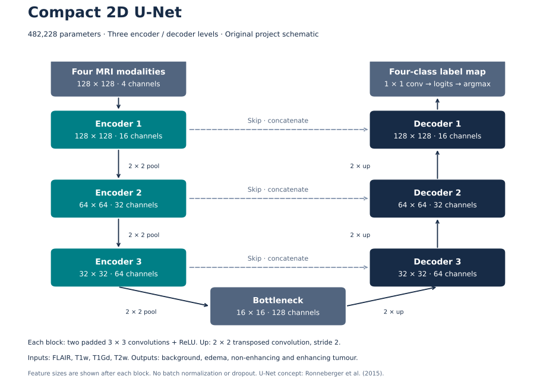

# Brain Tumour Segmentation · Medical AI Portfolio

**Ulas Yurt · Independent biomedical engineering project**

An end-to-end research study of multi-modal brain MRI segmentation: building a compact U-Net, investigating failure modes, and evaluating a frozen model on a reserved patient cohort. The project demonstrates medical-image processing, deep learning, statistical evaluation and transparent reporting of negative findings.

**97 held-out patients · 15,035 test slices · 482,228 model parameters**

This is a documentation-only portfolio. The implementation and research artifacts remain private. The model is for research and education; it is not clinically validated or intended to support patient-care decisions.

## Objective and approach

The objective was to segment tumour regions from four MRI modalities and assess whether development performance transferred to unseen patients from the same dataset. The study used Medical Segmentation Decathlon **Task01_BrainTumour**, derived from BraTS, and a compact **2D U-Net** built with PyTorch.

| Stage | Approach |
|---|---|
| Inputs | FLAIR, T1-weighted, contrast-enhanced T1-weighted and T2-weighted MRI |
| Preparation | Per-slice intensity clipping and normalization; resizing to 128 × 128 |
| Model | Three encoder/decoder levels, skip connections, four output classes |
| Development | Patient-disjoint partitions; model selection using development-validation evidence |
| Evaluation | One frozen evaluation on all axial slices of the reserved internal test cohort |
| Analysis | Patient-mean Dice, bootstrap confidence intervals, pooled confusion and failure counts |

The diagram describes this project's smaller U-Net variant. It is an original schematic, not a reproduction of the U-Net paper's figure. See [methodology](docs/METHODOLOGY.md) for the architecture, data split and experimental decisions.

## Results

Experiment 02 was selected using development evidence before the independent test. Both evaluation cohorts contain 97 patients and 15,035 slices. “Independent” means a reserved, disjoint **within-dataset** cohort; it does not mean external-site or prospective clinical validation.

| Region | Development mean Dice | Independent-test mean Dice | Test 95% CI |
|---|---:|---:|---:|
| Whole tumour | 0.6715 | **0.6628** | 0.6283–0.6943 |
| Tumour core | 0.4455 | **0.4606** | 0.4136–0.5065 |
| Enhancing tumour | 0.2343 | **0.2386** | 0.2070–0.2704 |

Dice measures segmentation overlap on a 0–1 scale; it is not diagnostic accuracy. Scores were calculated on the resized grid. Confidence intervals use 20,000 patient bootstrap resamples and describe patient-sampling uncertainty, not variation across training seeds or hospitals.

Whole-tumour overlap is substantially stronger than tumour-subclass overlap. Tumour was predicted on **35.14% of tumour-free test slices** (2,892/8,231, defined using native masks). Zero overlap occurred for non-enhancing tumour in **6/97** truth-present test cases and enhancing tumour in **8/96**. These are material limitations, not edge cases to hide behind the whole-tumour score.

See [full results and metric definitions](docs/RESULTS.md), including aggregate error charts and downloadable CSV tables.

## Experimental judgement: the V3 negative finding

A bounded eight-patient V3 readiness control improved aggregate training overlap but failed its readiness criteria: the non-enhancing class gain was below 0.05, only four of eight cases preserved that class within tolerance, and three had zero enhancing overlap. The planned intervention was therefore **not run**. This supports a decision to stop that experiment; it does not establish that negative-slice sampling is ineffective.

Experiment 02 remained the selected model before held-out evaluation. No test-driven tuning or repeat test evaluation was used to improve the reported result. [Experimental details →](docs/METHODOLOGY.md)

## Engineering and research achievements

- Built and assessed a compact multi-modal segmentation pipeline with explicit preprocessing and label definitions.
- Completed a frozen full-volume evaluation and separated patient-average performance from voxel-pooled performance.
- Investigated subclass collapse, spatial errors and false positives, including a reported unsuccessful experiment.
- Verified the private research software with 81 core synthetic tests and 35 archived pilot tests in the recorded release checks.
- Prepared aggregate evidence and original figures while keeping source code, scans, model artifacts and patient-level records private.

The test counts describe recorded private software checks, not tests supplied in this portfolio. The main achievement is a documented research workflow and an honest assessment of its model, rather than a claim of clinical readiness or state-of-the-art performance.

## Technical skills demonstrated

| Area | Skills |
|---|---|
| Medical imaging | Multi-modal MRI, NiBabel, NIfTI array handling, mask interpolation, label mapping |
| Machine learning | Python, PyTorch, U-Net, weighted cross-entropy and Dice loss, failure analysis |
| Scientific computing | NumPy, Matplotlib, cohort-level aggregation, patient bootstrap intervals |
| Research engineering | Synthetic tests, deterministic evaluation settings, artifact hashes, Git, reproducibility documentation |
| MedTech communication | Separating research evidence from clinical claims; privacy-aware reporting; transparent limitations |

## Limitations and next steps

The model has weak subclass segmentation, frequent false positives on tumour-free slices and no external or clinical validation. Downsampling can remove small lesions, and a 2D model lacks through-plane context. Historical training provenance is incomplete. Proposed next steps include better spatial context, stronger development-stage sampling experiments, native-resolution assessment and external validation; these remain untested. [Limitations and future work →](docs/LIMITATIONS.md)

## Scope, access and rights

This portfolio provides methods, aggregate measurements and original diagrams. It does not provide a runnable implementation or enable exact retraining or reconstruction of the patient bootstrap intervals. Source code, notebooks, model weights, MRI examples, patient identifiers and individual results are excluded.

Data must be obtained separately from the [Medical Segmentation Decathlon project](https://medicaldecathlon.com/) under the provider's terms; no data access is granted here. See [methodology and references](docs/METHODOLOGY.md).

No MIT or other open-content licence is applied. Rights in original documentation and figures are reserved to the extent they exist and are held by the author; dataset, publication and software rights remain with their respective holders. See [rights and attribution](RIGHTS.md).
