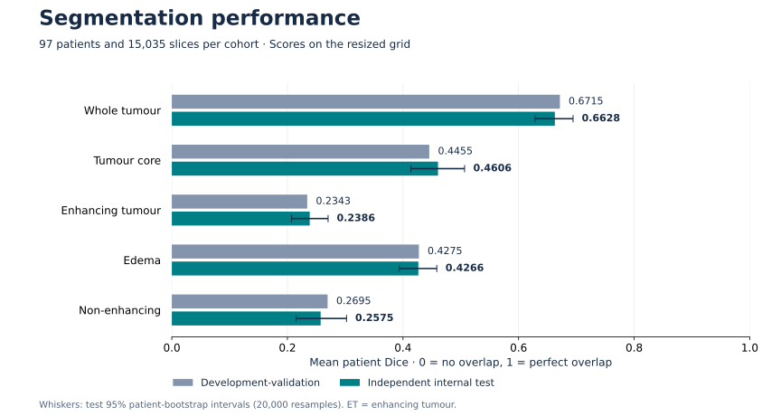
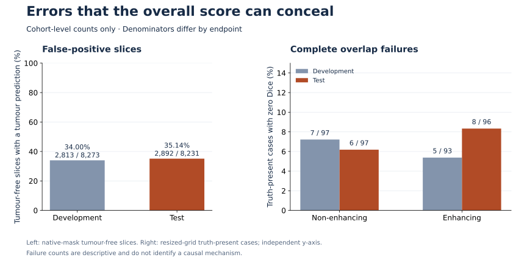
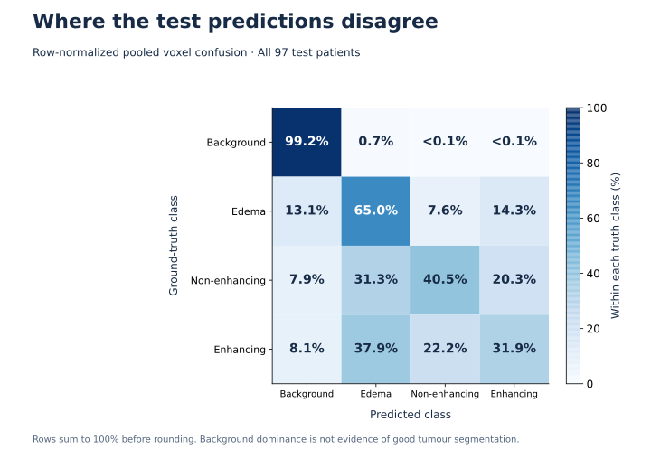

# Aggregate results

[Portfolio overview](../README.md) · [Methodology](METHODOLOGY.md) · [Limitations](LIMITATIONS.md)

## Evaluation scope

The frozen Experiment 02 model was evaluated once on **97 reserved internal-test patients and all 15,035 axial slices**. Development-validation also covered 97 patients and 15,035 slices. The cohorts are patient-disjoint and drawn from the same dataset. Development results informed model selection; test results did not.

## Overlap and uncertainty

| Target | Development mean Dice | Test mean Dice | Test 95% CI | Test pooled Dice |
|---|---:|---:|---:|---:|
| Whole tumour | 0.6715 | 0.6628 | 0.6283–0.6943 | 0.7060 |
| Tumour core | 0.4455 | 0.4606 | 0.4136–0.5065 | 0.5455 |
| Enhancing tumour | 0.2343 | 0.2386 | 0.2070–0.2704 | 0.3047 |
| Edema | 0.4275 | 0.4266 | 0.3935–0.4585 | 0.4669 |
| Non-enhancing | 0.2695 | 0.2575 | 0.2151–0.3023 | 0.3850 |

Dice is twice the intersection divided by the sum of predicted and reference region sizes. Both empty sets score 1; exactly one empty set scores 0. Patient-mean Dice averages all 97 patient scores equally. Pooled Dice combines voxel counts across the cohort and gives different weight to region sizes; it is not the same statistic.

Whole tumour combines labels 1, 2 and 3; tumour core combines labels 2 and 3; enhancing tumour is label 3 alone. Enhancing and ET are the same endpoint, not separate replications. All overlap uses the resized 128 × 128 × Z grid, including tumour-free slices.

The 95% intervals are percentile patient-bootstrap intervals using 20,000 resamples, seed 20261022 and linear quantiles. They reflect patient-sampling variation, not training-seed or external-site variation. No development intervals are supplied. Cohort differences are descriptive; no paired effect, significance or equivalence claim is made.

## Errors and class confusion

| Endpoint | Development | Independent test |
|---|---:|---:|
| Native tumour-free slices with a foreground prediction | 2,813 / 8,273 (34.00%) | 2,892 / 8,231 (35.14%) |
| Truth-present non-enhancing cases with zero overlap | 7 / 97 | 6 / 97 |
| Truth-present enhancing cases with zero overlap | 5 / 93 | 8 / 96 |

The slice endpoint defines absence using the native reference mask and detects foreground predictions on the resized output grid. It is a pooled slice ratio, not a mean of patient ratios, a patient detection rate or a clinical specificity estimate. Zero-overlap endpoints use truth presence on the resized scoring grid; their denominators exclude truth-absent cases.

The test cohort has four zero-overlap tumour-core cases out of 97 truth-present cases. Whole tumour and edema have nonzero overlap in every test case. These aggregate counts do not explain the cause of an individual failure.

| Foreground class | Test pooled precision | Test pooled recall |
|---|---:|---:|
| Edema | 0.3642 | 0.6504 |
| Non-enhancing | 0.3672 | 0.4046 |
| Enhancing | 0.2913 | 0.3192 |

The matrix pools voxel counts before row normalization. Each row shows the predicted-class distribution for one ground-truth class. Large background counts must not be interpreted as evidence of strong tumour-subclass performance.

## Performance context

The recorded CPU evaluation took **218.30 seconds**, with **679.56 MiB peak process resident memory**, on the project host. This is a single recorded run, not a portable throughput benchmark or a clinical deployment latency guarantee.

## Aggregate tables and interpretation

- [Overlap statistics](../results/aggregate_results.csv): five targets, development/test patient means, test interval bounds, pooled Dice and test failure counts. `test_truth_present_patients` is the denominator for `test_zero_overlap_patients`, not for the all-patient mean.
- [Confusion counts](../results/confusion_counts.csv): truth classes in rows, predicted classes in columns; integer counts on the test resized grid.
- [Error counts](../results/error_counts.csv): cohort, endpoint, numerator and denominator for the error chart. Zero-overlap counts use truth-present cases; false-positive counts use native tumour-free slices.

These tables contain cohort-level aggregates only. They can reproduce chart coordinates, normalized confusion percentages and displayed rounding. They cannot reconstruct individual results or bootstrap intervals. Values are retained at source precision in the overlap CSV and rounded to four decimals in tables; percentages are rounded as displayed. No patient records, source code, executable notebooks or model artifacts are supplied.
